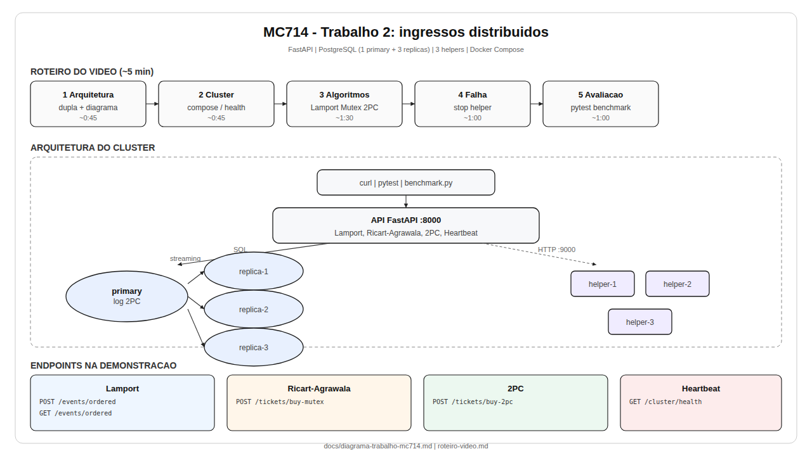
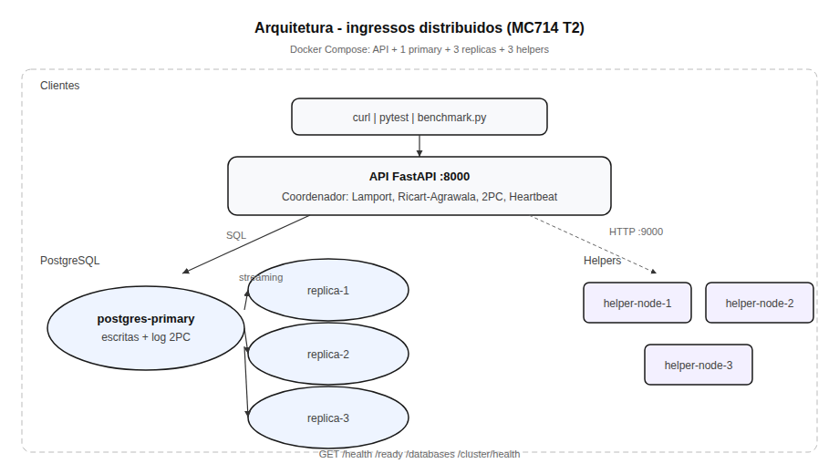
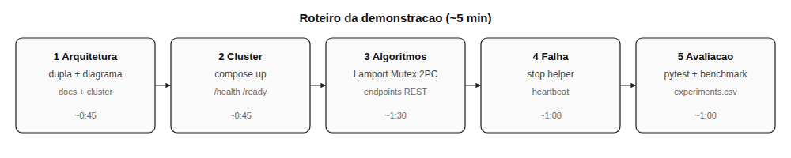
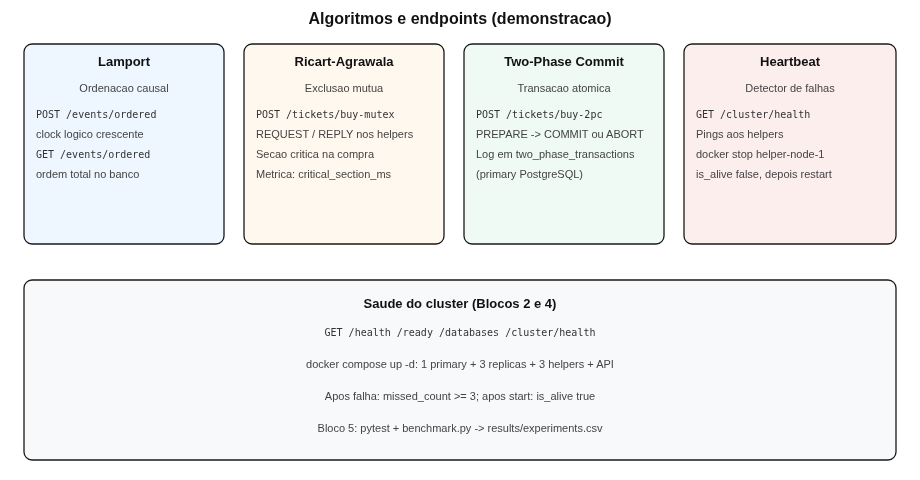

# Diagramas — MC714 Trabalho 2 (ingressos distribuídos)

Use no **Bloco 1** do vídeo no lugar do antigo `PROJECT_PLAN.md`.

## Como visualizar

| Onde | O que fazer |
|------|-------------|
| **Navegador (recomendado)** | Abra [`visualizar-diagramas.html`](visualizar-diagramas.html) — mostra PNG e SVG com zoom. |
| **Preview Markdown no editor** | Use as imagens **PNG** abaixo (muitos editores não exibem SVG embutido). |
| **Zoom / vídeo** | Abra os arquivos em [`images/*.svg`](images/) no navegador ou gere PNG com `./scripts/export-diagram-png.sh`. |

```bash
xdg-open docs/visualizar-diagramas.html
# ou
./scripts/export-diagram-png.sh
```

---

## 0. Slide one-pager (recomendado para o vídeo)



Formato **1280×720** (16:9). Vetor: [`images/slide-one-pager.svg`](images/slide-one-pager.svg).

---

## 1. Arquitetura do cluster



Vetor: [`images/arquitetura-cluster.svg`](images/arquitetura-cluster.svg)

| Componente | Papel no trabalho |
|---|---|
| **API FastAPI** | Orquestra algoritmos, expõe REST, roda detector de falhas |
| **Primary + 3 réplicas** | Persistência, replicação WAL, log `two_phase_transactions` |
| **3 helpers** | Participantes Ricart-Agrawala e 2PC; pares para Lamport e ping |

---

## 2. Fluxo da demonstração em vídeo (~5 min)



Vetor: [`images/fluxo-demonstracao.svg`](images/fluxo-demonstracao.svg)

---

## 3. Fluxos dos algoritmos (endpoints usados no roteiro)



Vetor: [`images/algoritmos-fluxos.svg`](images/algoritmos-fluxos.svg)

| Algoritmo | Endpoint principal | Ideia em uma linha |
|---|---|---|
| Lamport | `POST/GET /events/ordered` | Ordem total por relógio lógico |
| Ricart-Agrawala | `POST /tickets/buy-mutex` | Seção crítica distribuída na compra |
| 2PC | `POST /tickets/buy-2pc` | Commit ou abort unânime + log no primary |
| Heartbeat | `GET /cluster/health` | Detecta crash do helper após pings perdidos |

---

## Fontes editáveis

- **SVG:** `docs/images/*.svg`
- **Mermaid:** `docs/diagramas/*.mmd` (`arquitetura-cluster`, `fluxo-demonstracao`, `algoritmos-fluxos`)
- **PNG:** gere com `./scripts/export-diagram-png.sh` ou `npx @mermaid-js/mermaid-cli` a partir dos `.mmd`
